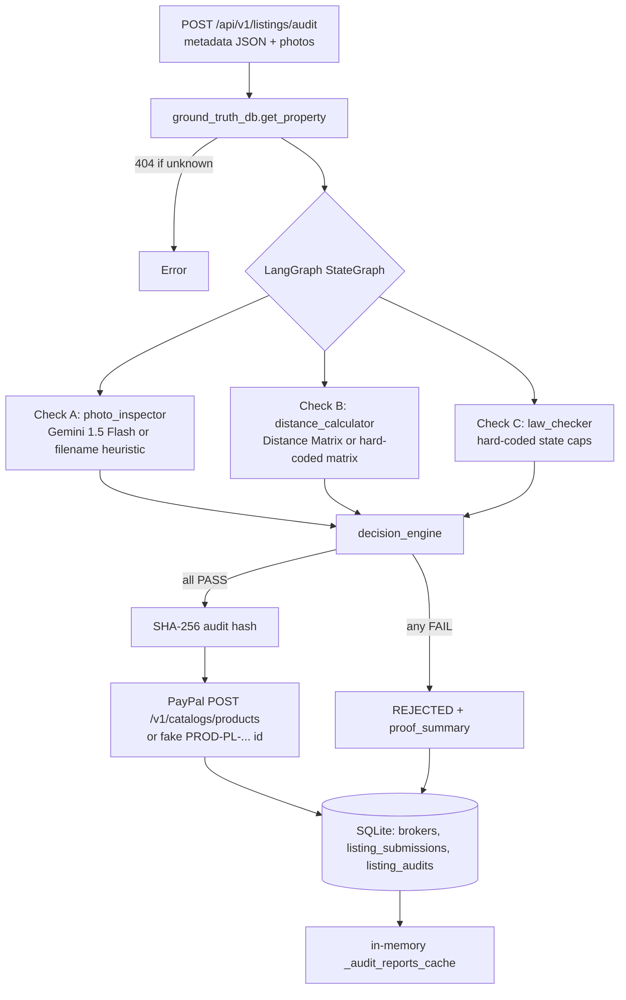
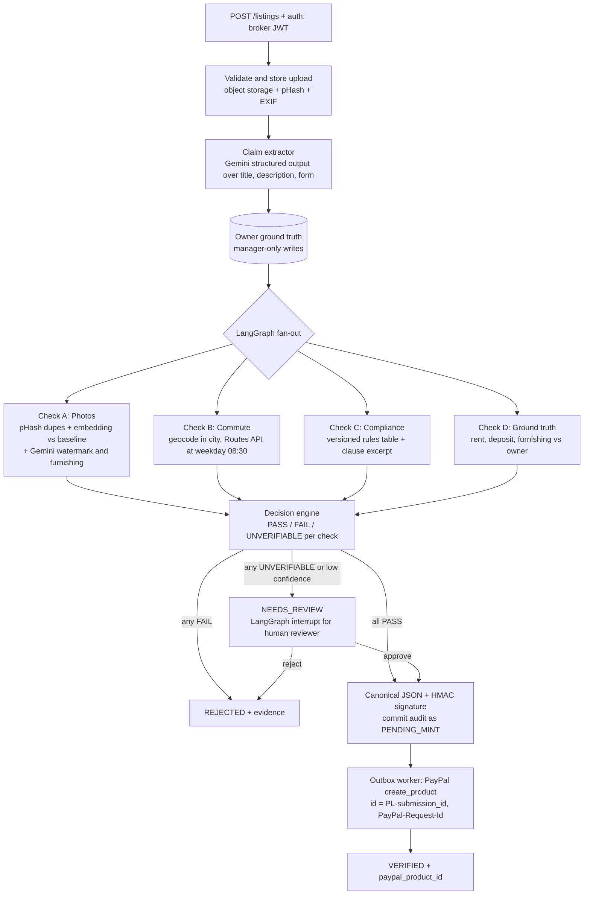

# Feature 1 — Multimodal Listing Audit & Commute-Truth Agent

> Code review of `backend/` against the PropLock AI Product Blueprint (Feature 1) and the flow diagram.
> Reviewed: 2026-10-22. Tests: `python -m pytest` → **9 passed**.

**Verdict:** Good hackathon skeleton. The structure is clean (FastAPI → LangGraph fan-out → 3 checks → decision engine → PayPal Catalog) and the tests pass. The trust logic still has **holes that let a lying broker get a VERIFIED badge**, though, and several "fixed" flaws in `feature1_implementation_plan.md` aren't actually fixed in code. Every major issue below was confirmed by running the code (see [§4](#4-proof-probes-that-were-run)).

---

## 1. What the feature does (as implemented)



| Component | File | What it really does |
|---|---|---|
| API | `app/api/v1/listings.py` | `POST /listings/audit`, `GET /listings/audit/{id}`, `GET /listings/{submission_id or property_id}` |
| Ground truth | `app/db/ground_truth_store.py`, `app/api/v1/ground_truth.py` | Reads the DB first, then an in-memory seed. `POST /ground-truth` writes only to memory |
| Orchestrator | `app/agents/orchestrator.py` | Compiled LangGraph: START → 3 parallel nodes → decision_engine → END |
| Check A | `agents/photo_inspector.py` + `services/gemini_vision.py` | Gemini JSON verdict per photo. Without a key (or on any error) it **guesses from the filename** |
| Check B | `agents/distance_calculator.py` + `services/maps_service.py` | Distance Matrix (`departure_time=now`), else a keyword lookup table, else a **made-up estimate** |
| Check C | `agents/law_checker.py` + `services/rag_engine.py` | Hard-coded dict of caps (3.0 months for every state). TN hard cap, KA warns at 3–6 months and blocks above 6 |
| Decision | `agents/decision_engine.py` | Requires all 3 to pass. Mints the PayPal product. Builds the proof summary |
| PayPal | `services/paypal_catalog.py` | OAuth on every call, `create_product`. On any failure returns a **fabricated** product id |

### Diagram vs code

| Diagram step | Status |
|---|---|
| A: Perceptual hash + CLIP | ⚠️ pHash computed, **result thrown away** (`is_exact_baseline_duplicate` never used). No CLIP |
| A: Compare with reference | ❌ Not used in the verdict |
| A: Gemini Vision check | ⚠️ Uses `gemini-1.5-flash` through the deprecated `google-generativeai` SDK (the blueprint says 2.5 Flash) |
| B: Extract address + claim | ❌ No extraction. Only structured `commute_claims` are checked; title and description are ignored |
| B: Mock DB or Maps API | ⚠️ Works, but uses "now" instead of peak hour, and the mock invents numbers |
| B: Compare claim vs route | ✅ `max(claimed×1.2, claimed+5)` tolerance |
| C: RAG finds legal rules | ❌ No retrieval. The markdown acts are never read. It's a dict lookup |
| C: Python rule check | ✅ |
| C: Cite source + date | ⚠️ Source cited, **no date or version** |
| Claim decision engine: rules + evidence thresholds | ⚠️ Rules yes, thresholds no (Gemini `confidence_score` never used) |
| Audit dashboard | ❌ Not in repo (no frontend) |
| No → "Fix or manual review" | ❌ Only VERIFIED or REJECTED. No review state |
| Yes → PayPal Catalog product | ⚠️ Works in the happy path, but fails over to a fake id (see M5) |

---

## 2. Issues

Severity: 🔴 **Major** (breaks the product promise or the demo) · 🟠 **Medium** · 🟡 **Minor**

### 🔴 Major

**M1. Broker claims are never compared with owner ground truth.**
`decision_engine` never checks `claimed_rent`, `claimed_deposit` or `claimed_furnishing` against `owner_truth.agreed_base_rent`, `agreed_base_deposit` and `furnishing_status`. Probe P1: a broker charging ₹55k (owner agreed ₹35k) and advertising "Fully Furnished" for an **Unfurnished** flat gets **VERIFIED**, and that inflated price is minted into PayPal. That's the bait-and-switch the whole feature exists to stop.
*Fix:* add a 4th deterministic node, `ground_truth_checker`:
```python
def check_ground_truth(sub, owner) -> GroundTruthResult:
    issues = []
    if sub.claimed_rent > owner.agreed_base_rent * 1.0:      # or an allowed markup policy
        issues.append(f"Rent {sub.claimed_rent} > owner-agreed {owner.agreed_base_rent}")
    if sub.claimed_deposit > owner.agreed_base_deposit:
        issues.append(f"Deposit {sub.claimed_deposit} > owner-agreed {owner.agreed_base_deposit}")
    order = {"Unfurnished": 0, "Semi-Furnished": 1, "Fully Furnished": 2}
    if order[sub.claimed_furnishing] > order[owner.furnishing_status]:
        issues.append(f"Claims {sub.claimed_furnishing}, owner registered {owner.furnishing_status}")
    return GroundTruthResult(verdict="FAIL" if issues else "PASS", issues=issues)
```

**M2. Lies in the title or description bypass Check B.**
Commute claims are only read from the optional `commute_claims` list. Probe P2: title `"2 MIN WALK TO METRO"` with no structured claims → `claims_evaluated=0` → **VERIFIED**. Brokers lie in the ad copy, not in a form field.
*Fix:* implement the diagram's "Extract address + claim" step. Run Gemini with a `response_schema` over `title + description` to pull out every `{destination, minutes, mode}` claim, plus furnishing and amenity claims. Merge them with the structured claims, and FAIL if the text contains a claim the broker didn't declare.

**M3. The mock maps fallback fabricates evidence.**
For any destination not in the table: `actual_minutes = max(claimed + 12, 18)`. That is *always* above tolerance, so every unknown destination gets "LIE DETECTED" with an invented "actual" time. Probe P3: an honest 30-min walk is reported as "actual 42 min". In a trust product, showing fake proof is worse than showing none.
The keyword match is also two-way substring (`kw in dest or dest in kw`), so destination `"a"` matches "tech park" (probe P4).
*Fix:* return `UNVERIFIABLE` (→ `NEEDS_REVIEW`) when there's no data. Match on exact normalised keys or geocoded place IDs.

**M4. The audit hash doesn't lock the broker's photos.**
`orchestrator.node_decision_engine` passes the **owner's baseline hashes**, not the hashes of the uploaded photos. It also hashes only the **first** commute claim. Probe P6: two submissions with different photos produce the **same** hash. That defeats "Flaw 2 fix". It also means the planned `UNIQUE (audit_sha256_hash)` index would reject a second honest audit.
On top of that, a plain SHA-256 of public fields isn't tamper-proof: anyone who can edit the DB can recompute it.
*Fix:* hash a canonical JSON of the **full submission** (all claims, sorted pHashes of the uploaded photos, owner snapshot, `submission_id`, `audit_id`, ruleset version). Sign it with `hmac.new(SERVER_SECRET, payload, sha256)`, or Ed25519 if third parties need to verify it.

**M5. PayPal failures quietly turn into fake success (fail-open), and the payload is invalid anyway.**
- The description is about 283 chars (probe P5). Catalog Products v1 limits `description` to 256 chars, so a real sandbox call returns 4xx. The code then returns `PROD-PL-...` as if it had minted. The demo "works" only because of this fallback.
- `category: "REAL_ESTATE"`: check this against the PayPal category enum. I don't believe it's a valid value; the real-estate entries are more specific (for example `REAL_ESTATE_AGENT`).
- Non-2xx responses aren't logged (no body, no `debug_id`).
- The "immutable anchor" claim is wrong: Catalog products can be PATCHed (`description`, `image_url`, `home_url`, `category`). The immutability has to come from **your** signed audit record, not from PayPal.

*Fix:* keep only `audit_id` + a short hash prefix in the description and point `home_url` at the audit page. Set the product `id` yourself (for example `PL-{submission_id}`) for natural idempotency. If PayPal fails, the audit should become `VERIFIED_PENDING_MINT` with a retry, never a fake id. Cache the OAuth token until `expires_in`.

**M6. Anyone can write the "source of truth".**
There's no auth on any endpoint. `POST /ground-truth` lets anyone register a property with any rent, deposit and photos, and then audit against it. Probe P7: a self-registered property → **VERIFIED**. Any client can also submit as any `broker_id`, and unknown brokers are auto-created with a fake licence.
`register_property` writes only to memory (lost on restart). `get_property` reads the DB first, so trying to "update" a seeded property silently does nothing.
*Fix:* role-based auth (owner/manager vs broker), with an API key or JWT for the demo. Ground truth goes into the DB, and only the `MANAGER` role can write it. `broker_id` comes from the token, not the request body.

**M7. Persistence fails silently and the report-retrieval path returns fabricated data.**
- `_persist_audit_to_db` wraps everything in `except: pass`. A DB failure loses the audit after PayPal already minted the product (an orphaned product, the dual-write problem the plan says is fixed).
- Photos, commute claims and all findings tables are **never written**.
- `GET /audit/{id}` from the DB then **invents** findings: `state="Verified Region"`, `demanded_deposit_months=2.0`, `total_photos_analyzed=1`, `statute_citation="Statutory Compliance"`. Clients get fake evidence.
- The persistence test writes `AUDIT-PERSIST-99` into the real `proplock_truth.db`. Later runs hit a PK collision that's silently rolled back, and the test still passes.

*Fix:* store the full `AuditReport` as JSON (`report_json` column) plus the normalised rows, in **one transaction**. Use an outbox: commit the audit as `PENDING_MINT` → mint with the idempotency key → update. Let DB errors raise. Point tests at a temp DB (`DATABASE_URL=sqlite:///:memory:` or `tmp_path`).

**M8. A fresh install doesn't run.**
`requirements.txt` is missing **`sqlalchemy`** and **`langgraph`**. A judge cloning the repo gets `ModuleNotFoundError`. It also lists both `google-genai` and the deprecated `google-generativeai`, and the code uses the deprecated one.
*Fix:* add `sqlalchemy>=2.0` and `langgraph`, drop `google-generativeai`, and pin versions.

### 🟠 Medium

| # | Issue | Fix |
|---|---|---|
| D1 | Photo check without Gemini (or on any Gemini error) decides by **filename** (`"nobroker"`, `"empty"`), so any stock photo named `living.jpg` passes. The fallback is silent: a production key outage verifies everything. | No key or error → `NEEDS_REVIEW`. Keep the heuristic only behind `DEMO_MODE=true`, and label the finding `source: "heuristic"`. |
| D2 | Photos aren't tied to the property: the baseline pHash comparison is computed and discarded, and the seeded baseline hashes are made-up strings. A stolen photo of another flat passes. | Use the pHash result. Add a CLIP/DINOv2 embedding similarity against the baseline rooms, plus a duplicate check of uploads against **all other properties'** photos (cross-listing theft). |
| D3 | Gemini fail-open defaults: `data.get("furnishing_claim_consistent", True)`. Free-text JSON parsing. `confidence_score` ignored. The prompt can be injected by text inside the image. | Use `google-genai` with `response_mime_type="application/json"` + `response_schema` (Pydantic). Default missing fields to *fail*. Below a confidence threshold → review. |
| D4 | `generate_content` (sync) and SQLAlchemy (sync) run inside async handlers and block the event loop. Photos are analysed one at a time. | `client.aio.models.generate_content` + `asyncio.gather` with a semaphore, or `run_in_threadpool`. |
| D5 | Maps: `departure_time="now"`, not 08:30 on the next weekday. `mode=transit` ignores `traffic_model`. The destination isn't scoped to the city ("Metro" is ambiguous). The element `status` isn't checked. The Distance Matrix API is legacy. | Compute the next weekday 08:30 IST as an epoch. Geocode `"{dest}, {city}"` first. Check `status == "OK"`. Use the Routes API `computeRouteMatrix` with `TRAFFIC_AWARE_OPTIMAL`. Cache results per (property, place_id, mode). |
| D6 | Legal content looks inaccurate, and the "RAG" is hard-coded. My understanding (check against the official gazette text before you demo): the Karnataka Rent Act caps advance at **10 months** (s.11), not 2–3 months under "Section 5". The Model Tenancy Act 2021 s.11 caps residential deposits at **2 months**, not "2–3". The 6-month Karnataka ceiling is a business rule, not law. `tamil_nadu_tenancy_2019.md` says the clause is "null, void, and **enforceable** against the landlord" (contradictory). No `maharashtra_rent_act.md` exists, though the plan lists it. | Make the rules data: `rules/deposit_caps.yaml` with `{state, max_months, hard_or_advisory, citation, section, source_url, effective_date, verified_on}`. Label platform policy separately from statute. Use RAG only to *show* the clause text, never to produce the number. |
| D7 | No input validation: `claimed_rent=0` gives `months=0` → PASS (probe P9). Negative or zero minutes are accepted. No upload count, size or type limits (PIL decompression-bomb risk). Zero photos passes at the orchestrator level (P8). | `Field(gt=0)` on rent, deposit and minutes. Require 1–20 images, ≤ 8 MB each, `image/jpeg|png|webp`. Set `Image.MAX_IMAGE_PIXELS`. |
| D8 | A node exception fails the whole graph with a 500. No per-check timeout. | Wrap each node: timeout or exception → `CheckResult(verdict="ERROR")` → `NEEDS_REVIEW`. |
| D9 | Public listing `GET /listings/SUB-x` shows `verified_badge=True` for a **rejected** submission if the same broker has any other verified audit of that property. It also shows the owner's photos instead of the broker's. | Resolve the badge from *that submission's* audit only. |

### 🟡 Minor

- `CORS allow_origins=["*"]` with `allow_credentials=True`: Starlette echoes any origin. Restrict it to the frontend origin.
- `DATABASE_URL` comes from `os.getenv`, so the `.env` value is ignored (not a `Settings` field). The relative SQLite path depends on the working directory.
- `init_db()` swallows exceptions. `datetime.utcnow()` is deprecated, so use `datetime.now(timezone.utc)`.
- The in-memory and DB seeds disagree (BLR has 2 baseline hashes in memory, 1 in the DB). `get_property` invents default hashes and URLs when none exist.
- `_audit_reports_cache` is an unbounded global and isn't shared across workers.
- The tests mutate the class-level `KNOWN_COMMUTE_MATRIX` (state leaks between tests). There are no API-level tests (`TestClient`) and no tests of the Gemini or PayPal paths with mocked HTTP (`respx`).
- The Karnataka 3–6 month advisory sets `deposit_exceeds_cap=True` but never reaches `proof_summary` on a VERIFIED listing, so buyers won't see the warning.
- The summary text says "exceeds allowed tolerance by +{delta}", but `delta` is measured against the claim, not the tolerance.
- `proplock_truth.db` and `.pytest_cache/` sit in the repo folder. Add them to `.gitignore`.

---

## 3. Recommended architecture

The current shape (parallel checks → judge) is right. The changes below make it **fail-closed, evidence-backed and reviewable**.



Key design decisions:

1. **A 3-state check result.** Every check returns `PASS | FAIL | UNVERIFIABLE` along with `evidence[]` and `source` (`gemini`, `routes_api`, `rules_v3`, `heuristic`). Only PASS counts toward the badge. A missing API key or a timeout never turns into PASS, and never into an invented "LIE".
2. **Add Check D (ground truth).** Deterministic comparison with the owner record. It's the cheapest check and catches the most common bait-and-switch.
3. **Claim extraction as the first node.** The LLM reads the ad copy; deterministic code judges it. This matches the diagram's "Extract address + claim" step.
4. **Human review via LangGraph `interrupt()`** plus a checkpointer (SQLite or Postgres saver). This implements the diagram's "Fix or manual review" branch and lets judges see an agent pause for a human.
5. **Signed, versioned audit record.** Canonical JSON (`json.dumps(sort_keys=True, separators=(",", ":"))`) of the submission, photo pHashes, owner snapshot, check results, ruleset and model versions → HMAC. Store it as `report_json`. `GET /audit/{id}` returns exactly what was signed, and `GET /audit/{id}/verify` recomputes the signature. That's your real "tamper-proof" story.
6. **Outbox for PayPal.** Commit the audit first, then mint with a deterministic product `id` and `PayPal-Request-Id`. Retries are safe and you never get orphans. Keep the description to `audit_id` + a hash prefix (≤ 256 chars).
7. **Rules as data, RAG for display.** Deposit caps live in a versioned table with `effective_date` and `source_url`. Retrieval fetches the clause text for the evidence card ("Cite source + date") but never decides the number.
8. **Auth and roles.** `MANAGER` writes ground truth, `BROKER` submits listings, `PUBLIC` reads verified listings.

Suggested build order before the demo: **M8 → M1 → M2 → M5 → M3/D1 (NEEDS_REVIEW) → M4 → M7 → M6**.

---

## 4. Proof: probes that were run

These ran against a scratch copy of `backend/` with a fresh DB and no API keys:

```text
P1 rent 55k vs owner 35k + Fully Furnished on Unfurnished flat: VERIFIED
P2 lie only in title/description, no structured claims: VERIFIED claims_evaluated= 0
P3 honest 30-min claim to unknown destination: True | fabricated actual = 42 | LIE DETECTED ...
P4 destination 'a' fuzzy-matches: 35
P5 PayPal description length: 283 (Catalog v1 limit 256)
P6 different broker photos -> same audit hash: True
P7 self-registered ground truth (unauthenticated POST) -> audit: VERIFIED
P8 zero photos at orchestrator level: VERIFIED
P9 rent=0, deposit=999999: PASS VERIFIED
```

The existing suite (`python -m pytest`) passes 9/9, but none of the tests cover these cases. Add each probe as a regression test once it's fixed.
