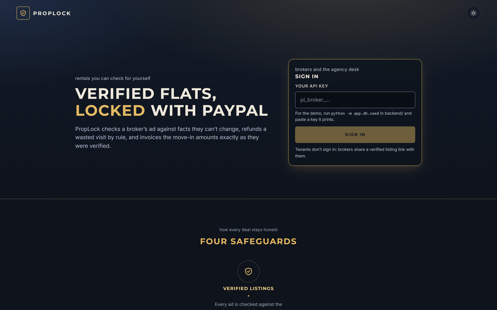
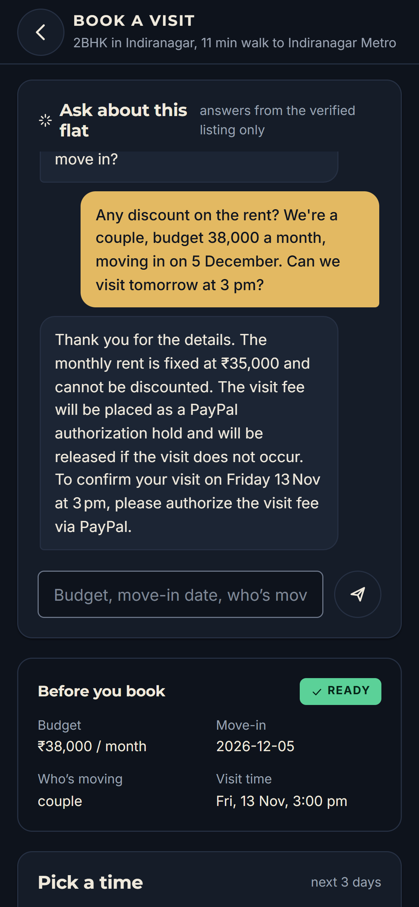
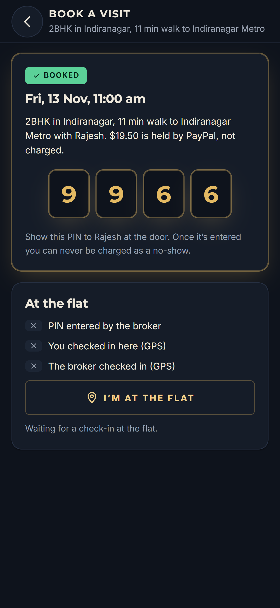
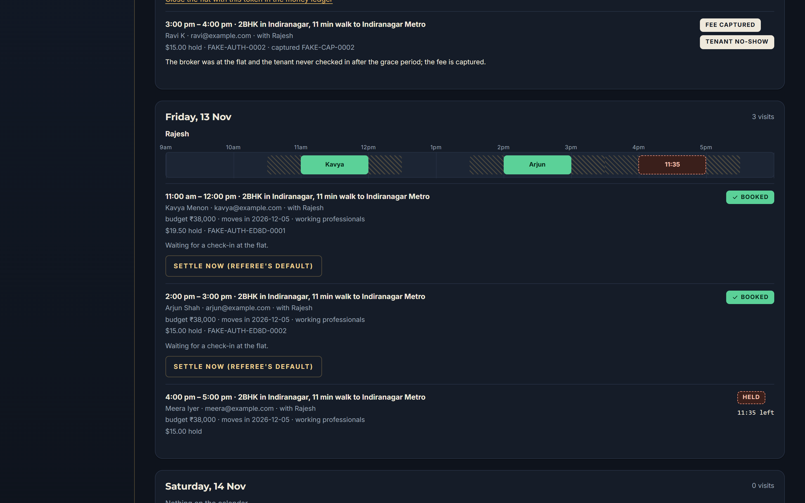
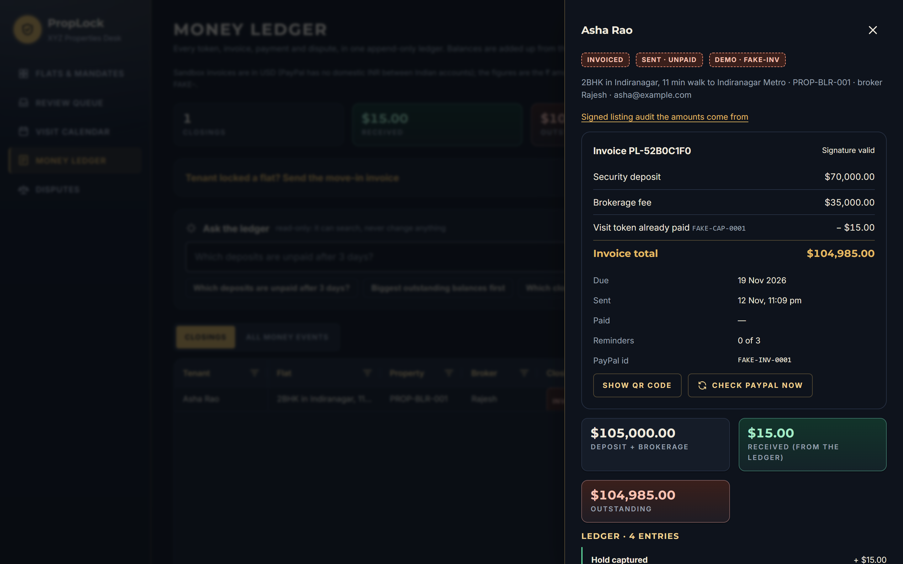

# PropLock AI

**Verified rental listings, refereed site visits and PayPal invoices, so neither broker nor tenant can cheat.**

PropLock is a trust layer for renting a flat through a broker. It checks every ad against facts the broker can't change. An AI assistant answers tenants only from those verified facts. **PayPal holds the visit fee** and releases or captures it based on proof from the door. The move-in invoice charges exactly what was verified.

Built for the PayPal AI Hackathon 2026 on the **PayPal developer platform (sandbox)** with **Groq-hosted LLMs**.

| Sign-in | Booking assistant | Door PIN |
|---|---|---|
|  |  |  |

| Visit calendar (agency) | Money ledger and PayPal invoice |
|---|---|
|  |  |

Background reading: [solution overview (PDF)](docs/PropLock_Solution_Overview.pdf) · [build log](docs/BUILD_LOG.md) · [design tokens](docs/frontend/design-tokens.md)

---

## 1. The problem

Renting a flat in an Indian metro usually goes through a broker, and both sides have good reason not to trust each other.

**Tenants can't trust the ad.** Common tricks:

| Trick | How it works |
|---|---|
| Fake or stolen photos | Photos of a nicer flat, copied from another portal or a builder's brochure |
| Commute lies | "5 min to metro" measured as a straight line, not the real walk at rush hour |
| Rent markup | Listed at ₹40,000; the owner gets ₹35,000 and the broker keeps the difference |
| Inflated deposit | 6–10 months asked for, sometimes beyond what state rules allow |
| Furnishing lies | "Fully furnished" turns out to be a bed and a fan |
| Token-advance scam | "Pay ₹10,000 to hold the flat", then the broker disappears |
| Hidden charges | Extra fees that appear only at signing |

**Brokers can't trust the tenant.** A broker's stock in trade is their time: driving across town, collecting keys and giving a tour. A verbal "I'll come Saturday at 4" costs the tenant nothing if they don't turn up. The PropLock blueprint *estimates* that up to 70% of free scheduled visits end in a no-show or a last-minute cancellation. Brokers are paid only when a deal closes, so each no-show is unpaid work.

**So both sides lose.** Tenants won't send token money through a raw payment link to an unknown broker, because it looks exactly like an advance-fee scam and nobody can get it back. Brokers, in turn, won't take tenants seriously without a commitment. Existing tools each cover a piece:

- **AI chatbots and AI agents** qualify leads and book tours, but they don't check whether the ad is true, and booking is free.
- **"Verified" badges** verify the person posting, not each claim in the ad.
- **Payment links** have no refund guarantee and no proof of attendance.

## 2. The solution

PropLock places a referee between the broker, the agency and the tenant. Money is never handed to the broker at booking time: **PayPal holds it**, and fixed rules decide from proof whether it is released or captured.

| | Feature | What it does |
|---|---|---|
| 1 | **Listing audit** | Before an ad goes live, four checks run in parallel. **A · Photos:** taken at the flat (GPS within 100 m) in the last 30 days, never reused from another flat, and compared with the owner's photos. **B · Commute:** claims are checked against real routes at rush hour. **C · Deposit:** checked against state rules, with the source cited. **D · Owner terms:** the rent range, deposit, furnishing and brokerage cap the owner agreed to. A failing ad comes back with the evidence and a suggested fix. A passing ad is **HMAC-signed** and published as a **PayPal Catalog product**, and anyone can verify the signature on the public page. |
| 2 | **AI booking assistant** | It answers tenants **only from the signed audit**. It refuses discounts and attempts to override its instructions, and it collects budget, move-in date, household and preferred time. Our own rules then re-check that the tenant qualifies. The tenant holds a slot for 15 minutes, with a 30-minute travel gap between the broker's visits at different flats. The fee is lower when booked early. |
| 3 | **Visit escrow and door referee** | The visit fee is a **PayPal Orders v2 `AUTHORIZE` hold**: held, not charged. At the door the broker types the tenant's 4-digit PIN, and both phones can check in by GPS. A pure rules engine then decides (table below). |
| 4 | **Invoice ledger** | When the tenant locks the flat, a **PayPal invoice** goes out for the verified deposit and brokerage **minus the captured visit token**, with reminders and a QR pay link. Every money event lands in an **append-only ledger** that you can question in plain English. If the tenant disputes the payment, a copilot drafts a response citing PropLock's own signed records, and a manager approves it before it is sent. |

**How a visit ends (Feature 3):**

| What happened | Proof needed | PayPal |
|---|---|---|
| Tenant visited, not interested | Correct PIN, or the tenant's GPS at the flat | **void**: $0 |
| Tenant wants the flat | Check-in + tenant taps Lock + broker approves | **capture**: becomes the move-in token |
| Tenant didn't show | Broker's GPS at the flat *before* claiming, 30 min after the start | **capture**: no-show fee |
| Broker didn't show | Tenant's GPS and a live photo at the flat, no PIN or broker check-in | **void**, and the listing is taken down |
| Nobody proved anything | The deadline passes | **void** |

A correct PIN proves both people were at the door, so neither no-show claim can succeed after it.

## 3. How it solves the existing problem

| Problem | PropLock's answer |
|---|---|
| Fake photos | The check-in photo must be within 100 m of the owner-verified pin and under 30 days old. Perceptual hashes catch photos reused across flats. The vision model compares extra photos with the owner's. Tenants see the **owner's** photos. |
| Commute lies | Claims are measured on real routes (OpenStreetMap, or Google Routes at rush hour), with a margin of ×1.2 or +5 minutes, whichever is larger. |
| Rent markup, inflated deposit, hidden charges | The ad must fit the owner's mandate. The deposit is checked against state rules with a citation. Brokerage is a separate, capped field. The tenant page shows the full move-in total, and the invoice can only charge what was verified. |
| Bait listings, stale ads | Only LIVE listings with a signed audit are shown. A listing expires unless the broker confirms it is still available every 7 days. |
| Token-advance scam | No money goes to the broker. PayPal holds the visit fee, and the rules release it unless there is proof. |
| Tenant no-shows | The PayPal hold is real commitment. A no-show is captured only on the broker's own GPS proof from the flat. |
| "It's my word against yours" | Every proof, decision and money event is stored append-only. Audits are signed, and disputes get an evidence pack with source ids. |
| Tampering with the records afterwards | `/public/audits/{id}/verify` recomputes the signature and compares it with the current database rows, so an edit made straight in the database is caught. |

## 4. Architecture

```text
             Broker app (phone)        Agency desk (web)        Tenant pages (no login)
                     └──────────────────────┬──────────────────────┘
                                React + Vite + TypeScript  (X-API-Key / hold token)
                                            │
                                   FastAPI backend (Python 3.11)
   ┌──────────────────────────┬─────────────┴──────────────┬─────────────────────────────┐
   │ F1 audit pipeline        │ F2 booking                 │ F3 escrow referee            │ F4 closing + ledger
   │ LangGraph:               │ Groq assistant →           │ PIN · GPS · photo proof      │ signed invoice
   │ extract claims (Groq) →  │ rules re-check "ready" →   │ (append-only) → pure rules → │ append-only ledger
   │ A·B·C·D in parallel →    │ slots + travel gaps →      │ capture / void               │ ledger copilot (Groq)
   │ decide → sign (HMAC)     │ 15-min hold (row lock)     │                              │ dispute copilot (Groq)
   └─────────────┬────────────┴─────────────┬──────────────┴──────────────┬──────────────┘
                 │                          │                             │
          SQLAlchemy + Alembic (SQLite for the demo; Postgres-ready, with an exclusion constraint)
                 │
          Outbox (commit first, then call PayPal; fixed PayPal-Request-Id; retries with backoff)
                 │
   PayPal sandbox: Catalog Products · Orders v2 AUTHORIZE · Authorizations capture/void ·
                   Invoicing v2 · Webhooks (verified) · Customer Disputes · JS SDK buttons
   AI:             Groq openai/gpt-oss-120b (text) · Groq qwen/qwen3.8-27b (vision)
   Maps:           OpenStreetMap (Nominatim + OSRM)  or  Google Routes API
```

Design rules that hold everywhere:

- **The AI proposes; the rules decide.** Claim extraction, the assistant, the copilot and dispute drafts are model outputs, and each is checked by deterministic code. The assistant's "ready to book" can only be overruled toward "not ready". The copilot only fills in a whitelisted, read-only query. A dispute draft is never sent without a person's approval.
- **"Couldn't check" is never a pass.** No key, no route data, an unsure model or an unknown state all send the item to a person.
- **Money moves once.** Every PayPal call runs from the outbox after the decision is saved, with a request id derived from our own record. Ledger entries have unique idempotency keys. Webhooks are verified, stored raw and applied once.
- **Evidence is append-only.** The ORM refuses updates and deletes on ledger entries and check-in proof. Balances are always summed from entries, never stored.
- **No double booking.** A hold takes a lock on the broker's row before reading the calendar. A four-thread race test proves only one tenant wins.

## 5. Impact on real-world data

PropLock's checks run on **real data sources**, not on what the broker types:

| Data | Source | What PropLock does with it |
|---|---|---|
| Routes and travel times | **OpenStreetMap** (Nominatim geocoding, OSRM routing for walking and driving), called live. Optionally Google Routes API with traffic. | Measures each commute claim on a real route from the owner-verified pin. OSM has no traffic or transit data, so a driving claim that only passes on empty roads, or any transit claim, goes to a manager instead of being guessed. |
| Photos | The device's GPS and the photo's EXIF data, plus perceptual hashes (pHash) | Distance to the flat, photo age, and reuse across flats. Photos are stored by content hash. |
| Deposit law | `backend/app/rules/deposit_caps.yaml`: each rule has a citation, section, source URL, effective date and a `verified` flag | Tamil Nadu: the 2017 tenancy Act's 3-month cap, flagged as "not yet verified against the gazette". Karnataka: labelled as PropLock policy, not law. An unlisted state goes to a manager. |
| The owner's terms | The agency's mandate (rent range, deposit cap, furnishing, brokerage cap) | Each ad field is compared with it. No mandate means the broker can't list at all (403). |
| Money | **PayPal sandbox**: Orders, Authorizations, Invoicing, Webhooks, Disputes | Real order ids, authorization ids and invoice ids flow into the ledger. Invoicing has been verified end to end in the sandbox (create, retry, read back, send, QR, cancel). |
| Ad text and tenant questions | Groq LLMs | Read as untrusted input, fenced in the prompt, and never allowed to override the rules. |

What this changes in practice:

- **Visible lies get caught before publishing.** In the bundled demo, a typical inflated ad (₹40,000 rent against an owner range of ₹32,000–35,000, a ₹1,40,000 deposit, "fully furnished" for an unfurnished flat, a "2 min walk" that is really 11) comes back with **6 mismatches**, each with evidence and a suggested fix. The corrected ad goes LIVE.
- **Visit fees become refundable by rule.** A tenant who visits and passes pays $0; a tenant who never shows pays the broker. Neither side can claim the other's money on their own word.
- **Tenants pay only the verified move-in total.** The invoice is built from the signed audit ($70,000 deposit + $35,000 brokerage − $15 token = **$104,985** in the demo), and a manager override needs a written note that is recorded in the ledger.
- **Disputes are answered from records, not memory.** The evidence pack cites the signed audit, the check-in photo, the invoice and the ledger entries by id.

Amounts are shown in rupees on the listing. The PayPal sandbox invoices in USD, because PayPal has no domestic INR between Indian accounts.

## 6. Setup

You need **Python 3.11**, **Node 20+**, and optionally Groq and PayPal sandbox keys. Without keys, `DEMO_MODE=true` uses demo PayPal ids (`FAKE-…`) and demo routes, and anything that would need a real AI answer goes to manual review.

### Backend

From `backend/`:

```bash
python -m venv .venv
```
```bash
.venv/Scripts/python -m pip install -e ".[dev]"
```
```bash
cp .env.example .env
```

Edit `.env`. For the full demo set:

- `DEMO_MODE=true`
- `GROQ_API_KEY=…`, `GROQ_TEXT_MODEL=openai/gpt-oss-120b`, `GROQ_VISION_MODEL=qwen/qwen3.8-27b`
- `MAPS_PROVIDER=osm` (free, no key)
- optionally `PAYPAL_CLIENT_ID` and `PAYPAL_CLIENT_SECRET` (sandbox REST app)

```bash
.venv/Scripts/alembic upgrade head
```
```bash
.venv/Scripts/python -m app.db.seed
```

The seed prints three API keys (the agency manager, an honest broker and a dishonest broker) and saves them to `demo_keys.json`.

```bash
.venv/Scripts/python -m uvicorn app.main:app --reload
```

The API runs at http://localhost:8000 (interactive docs at `/docs`; click **Authorize** and paste a key). The background worker retries PayPal calls, sends reminders, expires stale listings and visit holds, and settles visits past their deadline:

```bash
.venv/Scripts/python -m app.services.outbox
```

On macOS or Linux, use `.venv/bin/` instead of `.venv/Scripts/`.

### Frontend

From `frontend/`, with the backend on port 8000:

```bash
npm install
```
```bash
npm run dev
```

Open http://localhost:5173 and paste a key from `demo_keys.json`: a broker key opens the broker app, and the manager key opens the agency desk. Tenants don't sign in; brokers share `/l/{listing id}`. Vite forwards `/api/*` to the backend. A deployed build sets `VITE_API_BASE`, and the backend's `CORS_ORIGINS` must list the site's origin.

### One-command demos (each uses a throwaway database)

```bash
.venv/Scripts/python -m scripts.demo
```
Feature 1: a dishonest ad gets NEEDS_FIX → the pre-check suggests fixes → it goes LIVE as a PayPal product → a database edit is caught by `/verify`.

```bash
.venv/Scripts/python -m scripts.demo_feature3
```
Features 2 and 3: five tenants book visits, and each visit ends a different way (passed, locked, tenant no-show, broker no-show, no proof).

```bash
.venv/Scripts/python -m scripts.demo_feature4
```
Features 2–4: book, lock and capture, invoice, a forged webhook refused, the real one applied once, a ledger question, then a dispute with an evidence pack, a draft and approval.

Each demo exits non-zero if any step behaves differently. Add `--offline` (`demo`, `demo_feature4`) to skip Groq.

### Sandbox spikes (real PayPal calls)

```bash
.venv/Scripts/python -m scripts.spike_invoicing
```
```bash
.venv/Scripts/python -m scripts.spike_orders --create-only
```

`spike_invoicing` sends a real sandbox invoice. `spike_orders` creates AUTHORIZE orders; without `--create-only` it waits for you to approve them with a **sandbox buyer**, then captures one and voids the other.

### Tests

```bash
.venv/Scripts/python -m pytest -q
```
```bash
npm run build
```

474 backend tests; none of them calls the network. The frontend build runs a strict TypeScript check.

### Configuration

| Variable | Used for | Without it |
|---|---|---|
| `GROQ_API_KEY`, `GROQ_TEXT_MODEL` | claim extraction, booking assistant, ledger and dispute copilots | claims go to review; the assistant says it is offline and the tenant picks a time directly; the ledger copilot says it couldn't search; dispute drafts use a template |
| `GROQ_VISION_MODEL` | comparing extra photos with the owner's | extra photos go to review |
| `MAPS_PROVIDER=osm` / `GOOGLE_MAPS_API_KEY` | real routes (free OSM, or Google with traffic) | demo route table in `DEMO_MODE`, else review |
| `PAYPAL_CLIENT_ID`, `PAYPAL_CLIENT_SECRET`, `PAYPAL_API_BASE` | Catalog, Orders, Invoicing, Disputes (sandbox) | `DEMO_MODE` uses `FAKE-` ids; otherwise PayPal steps wait in the outbox |
| `PAYPAL_WEBHOOK_ID` | verifying PayPal webhooks | every webhook is rejected (in `DEMO_MODE` only script-signed ones pass) |
| `DEMO_MODE` | demo routes, demo PayPal, demo-signed webhooks | missing services are "couldn't check" |
| `INVOICE_CURRENCY`, `INVOICE_DUE_DAYS`, `INVOICE_REMINDER_OFFSETS` | invoices | `USD`, 7 days, `-1,1,3` |
| `VISIT_FEE_BASE`, `VISIT_WINDOW_DAYS`, `VISIT_SOFT_HOLD_MINUTES`, `VISIT_TRANSIT_BUFFER_MINUTES`, `VISIT_HOURS`, `VISIT_UTC_OFFSET_MINUTES` | visit booking | $15 (−20% booked 48 h ahead, +30% under 12 h), 3 days, 15 min, 30 min, 9–18, IST |
| `AUDIT_SECRET` | signing audits and PIN hashes | dev default (refused when `APP_ENV=production`) |
| `DATABASE_URL`, `UPLOAD_DIR`, `CORS_ORIGINS` | storage and the browser origin | `sqlite:///./proplock.db`, `uploads/`, `http://localhost:5173` |

## 7. Screens and API

| Who | Screens |
|---|---|
| Tenant (no login) | `/l/{id}` verified listing and move-in total · `/v/{audit id}` "is this genuine?" · `/l/{id}/visit` assistant, slots, hold, PayPal, door PIN, Pass/Lock, broker-no-show report |
| Broker (phone-first) | `/b` listings · check-in photo · write the ad with a live pre-check · audit result with fixes · live listing · `/b/visits` visits and **At the door** · `/b/ledger` own closings |
| Agency manager (web) | `/m` flats and mandates · `/m/reviews` review queue · `/m/visits` visit calendar · `/m/ledger` money ledger, invoice drawer, close a flat, ask the ledger · `/m/disputes` evidence, draft, approve |

| Role | Main endpoints |
|---|---|
| Public | `GET /public/listings/{id}` · `GET /public/audits/{id}/verify` · `POST /public/listings/{id}/assistant` · `GET …/slots` · `POST …/visits` · `POST /public/visits/{id}/paypal-order` · `…/authorize` · `…/checkin` · `…/photo` · `…/decision` · `…/release` (visit calls carry `X-Hold-Token`) |
| Broker | `POST /broker/listings` · photos · `POST /broker/precheck` · `…/submit` · `…/confirm-availability` · `…/mark-rented` · `POST /broker/listings/{id}/close` · `POST /broker/visits/{id}/pin` · `…/checkin` · `…/approve-lock` · `…/claim-no-show` |
| Manager | properties, photos, mandates, reviews · `POST /manager/listings/{id}/close` (override with a note) · disputes, draft, approve · `POST /manager/visits/{id}/settle-now` |
| Both | `GET /me` · `GET /visits` · `GET /ledger` · `GET /ledger/closable` · `GET /closings/{id}` · `…/refresh` · `…/qr` · `POST /ledger/copilot` |
| PayPal | `POST /webhooks/paypal` |

Every request carries an `X-API-Key` header, except `/public/*` and `/health`.

## 8. Project layout

```text
backend/
  app/
    domain/     pure rules: owner terms, commute, deposits, photos, decision, signing,
                visit_rules (fee, slots, clashes), referee (visit outcomes, PIN), ledger, invoice_rules
    adapters/   Groq (text + vision), maps (OSM / Google), PayPal catalog, orders, invoicing; each with a fake
    agents/     LangGraph audit pipeline, booking assistant, ledger copilot, dispute copilot
    services/   audits, photos, listings, visits, escrow + escrow jobs, closings, ledger, webhooks, outbox
    api/        manager, broker, audits, public, visits, closings, disputes, webhooks
    rules/      deposit_caps.yaml, commute_matrix.yaml (demo routes)
    db/         SQLAlchemy models, seed
  alembic/      migrations
  scripts/      demos and sandbox spikes
  tests/        unit/ and api/ (474 tests, no network)
frontend/
  src/styles/   tokens.css (design tokens: midnight and gold, light theme)
  src/pages/    broker/, manager/, public/, visits/, escrow/, ledger/
docs/           solution overview, build log, design tokens, screenshots
plans/          feature plans
```

## 9. Known limits

- **PayPal, verified vs mocked.** Invoicing is verified end to end in the sandbox, and so is creating AUTHORIZE orders. The full approve → capture/void flow needs a sandbox buyer (run `spike_orders`). Webhooks need a public URL and `PAYPAL_WEBHOOK_ID`, so their handling and dispute evidence are tested against mock servers. The demos use `FAKE-` ids.
- **GPS can be spoofed** by a determined client, for both check-in photos and door check-ins. The PIN is the strong proof, and GPS-only outcomes show the referee's reason to the manager.
- **OpenStreetMap has no live traffic or transit;** those claims go to a manager.
- **The Tamil Nadu deposit cap is unverified** against the gazette. Karnataka's limit is PropLock policy, not law.
- **No-show fees are not paid out to brokers** (PayPal Payouts is out of scope); they stay with the agency and are recorded in the ledger.
- **Demo-grade sign-in:** an API key kept in local storage. Rate limits are in memory, for a single process.
- **One time zone** for visits (`VISIT_UTC_OFFSET_MINUTES`, India by default).
- **The frontend has no automated tests;** it was checked by hand in the browser (see the build log).
