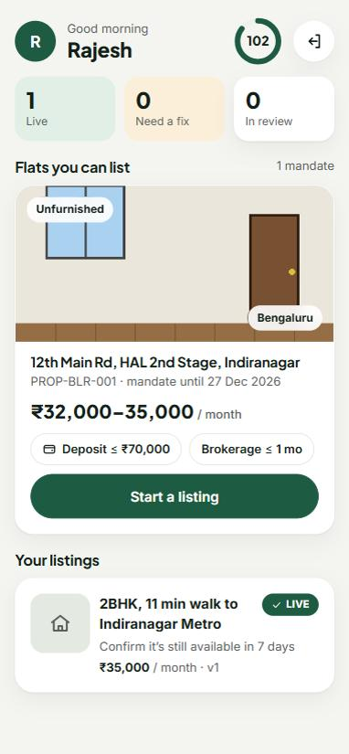
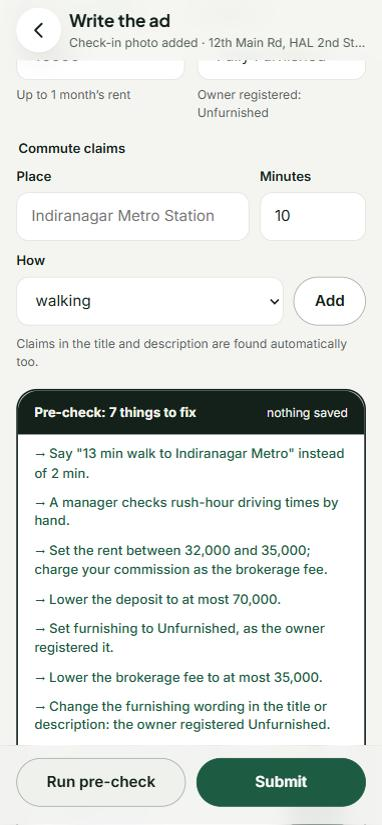
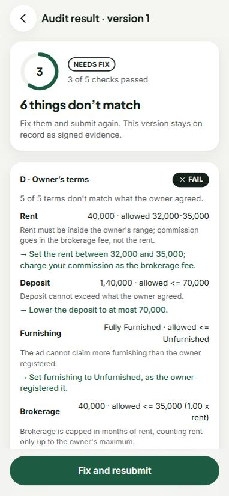
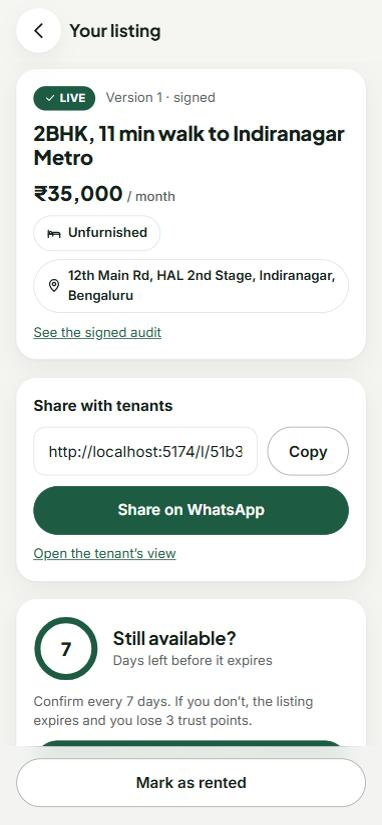
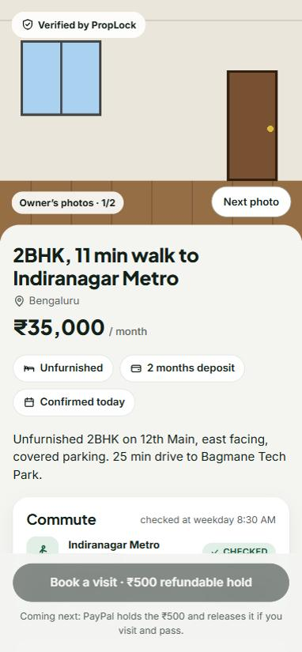
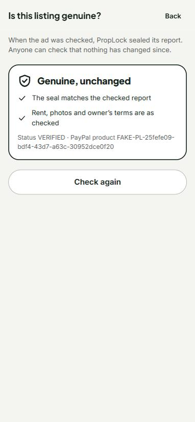
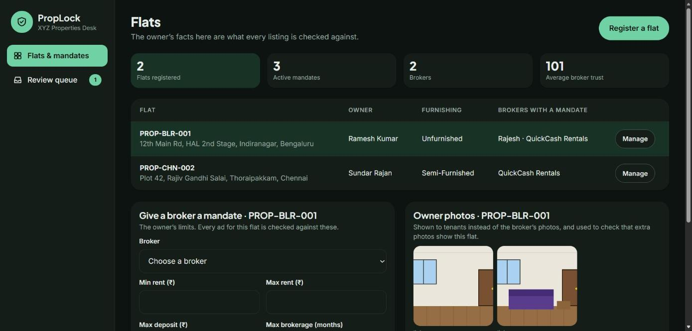
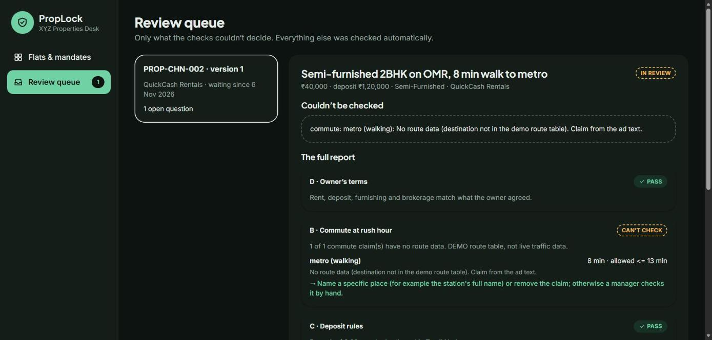

# PropLock AI: Listing Audit (Feature 1) and Invoice Ledger (Feature 4)

PropLock checks a broker's rental ad against facts the broker can't change before it goes live.
It checks the owner's agreed terms, rush-hour routes, state deposit rules, and photos taken at the flat.
It then signs the result and publishes the verified listing as a **PayPal Catalog product**.

**Feature 4** closes the deal on that verified listing. When a tenant locks the flat, a **PayPal invoice** goes out for the verified deposit and brokerage, minus the visit token already captured. Every money event lands in an **append-only ledger** shown in an AG Grid cockpit that you can question in plain English. When a payer disputes, a copilot drafts a cited response from PropLock's own signed records, and a person approves it.
Features 2–3 (AI qualification, the ₹500 visit hold) are designed, not built; Feature 4 takes a simulated visit token in demo mode until Feature 3 exists.

Built for the PayPal AI Hackathon. Background: [docs/PropLock_Solution_Overview.pdf](docs/PropLock_Solution_Overview.pdf).
Step-by-step build notes: [docs/BUILD_LOG.md](docs/BUILD_LOG.md).

## Screenshots

| Broker home | Pre-check with suggested fixes | Audit result: needs fix |
|---|---|---|
|  |  |  |

| Live listing | Tenant: verified listing | Tenant: is this genuine? |
|---|---|---|
|  |  |  |

**Agency manager (web, dark theme)**





## How an ad is judged

```text
broker submits ──► mandate gate (403 without one)
                    │
                    ▼
            claim extractor (Groq LLM reads the title + description)
                    │
     ┌──────────────┼──────────────┬──────────────┐      in parallel (LangGraph)
     ▼              ▼              ▼              ▼
 A · photos     B · commute    C · deposit    D · owner terms
 GPS ≤100 m,    rush-hour      state rules    rent range, deposit,
 ≤30 days,      route, ×1.2    with citation  furnishing, brokerage
 no reuse,      or +5 min
 same flat
     └──────────────┴──────┬───────┴──────────────┘
                           ▼
       any FAIL → NEEDS_FIX (evidence + suggested fix)
       any UNVERIFIABLE → IN_REVIEW (a manager decides)
       all PASS → signed (HMAC) → outbox → PayPal product → LIVE
```

"Couldn't check" (no key, no route data, an unsure vision model) is **never** turned into a pass or into a made-up number.

## Quick start (Windows, Python 3.11)

From `backend/`:

```bash
python -m venv .venv
```
```bash
.venv/Scripts/python -m pip install -e ".[dev]"
```
```bash
cp .env.example .env
```
Edit `.env`: set `GROQ_API_KEY`, `GROQ_TEXT_MODEL=openai/gpt-oss-120b`, `GROQ_VISION_MODEL=qwen/qwen3.8-27b`, and for a demo `DEMO_MODE=true`.
```bash
.venv/Scripts/alembic upgrade head
```
```bash
.venv/Scripts/python -m app.db.seed
```
This prints three API keys (manager, an honest broker, a dishonest broker) and saves them to `demo_keys.json`.
```bash
.venv/Scripts/python -m uvicorn app.main:app --reload
```
Open http://localhost:8000/docs, click **Authorize**, and paste a key.

Optional background worker (retries PayPal publishing, expires listings that weren't confirmed for 7 days):
```bash
.venv/Scripts/python -m app.services.outbox
```

### The web app (Node 20+)

With the backend running on port 8000, from `frontend/`:

```bash
npm install
```
```bash
npm run dev
```
Open http://localhost:5173 and paste a key from `demo_keys.json`. A broker key opens the broker app; the manager key opens the agency desk. Vite forwards `/api/*` to the backend, so no CORS setup is needed in development. A deployed build sets `VITE_API_BASE` to the API's URL, and the backend's `CORS_ORIGINS` must list the site's origin.

| Who | Screens |
|---|---|
| Broker (phone-first) | My listings · check-in photo (GPS distance to the flat) · write the ad with pre-check · audit result with fixes · live listing (share, "still available", rented) |
| Manager (web) | Flats & mandates (register a flat, owner photos, give or revoke mandates) · review queue (approve or send back, with a note) |
| Tenant (no login) | `/l/{listing id}`: the verified listing and move-in total · `/v/{audit id}`: is this genuine? |

## The whole story in one command

```bash
.venv/Scripts/python -m scripts.demo
```

On a throwaway database, the demo runs these steps and prints each result:
1. A dishonest ad gets **NEEDS_FIX** with evidence.
2. The pre-check suggests the corrected wording.
3. The resubmitted ad is **VERIFIED → LIVE** as a PayPal product.
4. The public page is shown.
5. Someone edits the database, and `/verify` catches it twice.

The script exits non-zero if any step behaves differently. Add `--offline` to skip Groq.

## Feature 4: from locked flat to paid invoice

```text
Feature 3 visit hold (simulated: POST /dev/ledger/simulate-capture, DEMO_MODE)
        │ HOLD_CAPTURED $15
        ▼
close the LIVE listing ──► invoice = signed deposit + signed brokerage − token
        │                  (other amounts: manager override + note, recorded)
        │  one commit: closing + signed invoice + ledger entry + outbox job
        ▼
outbox ──► PayPal: create → send → reminders (due−1, +1, +3; none once paid)
        ▼
verified webhook / "Check PayPal now" ──► INVOICE_PAID, once ──► closing PAID
        ▼
dispute webhook ──► evidence pack (audit, check-in, invoice, ledger, trust; each with a source id)
                ──► cited draft (Groq, else a template) ──► manager approves the text ──► PayPal
```

The rules: the ledger is append-only (the ORM refuses updates and deletes); balances are summed from entries, never stored; every PayPal call goes through the outbox with a fixed `PayPal-Request-Id`; an unverified webhook changes nothing; the LLM only writes query objects and drafts, never a money-moving call.

```bash
.venv/Scripts/python -m scripts.demo_feature4
```
Runs the whole story on a throwaway database, using demo PayPal invoicing (`FAKE-INV-` ids) and webhooks signed by the script. Add `--offline` to skip Groq.

| Who | Screens |
|---|---|
| Manager | **Money ledger** (`/m/ledger`): KPIs, AG Grid of closings and money events, "Ask the ledger", invoice drawer (breakdown, pay link, QR, timeline, cancel), close a flat with an optional override · **Disputes** (`/m/disputes`): evidence pack, draft, approve |
| Broker | **My money ledger** (`/b/ledger`, the ledger icon on the home screen): own closings only; close a flat with a captured token |

| API | |
|---|---|
| Broker | `POST /broker/listings/{id}/close` |
| Manager | `POST /manager/listings/{id}/close` (override) · `POST /closings/{id}/cancel` · `GET /manager/disputes` · `POST /manager/disputes/{id}/draft` · `POST …/approve` |
| Both | `GET /ledger` · `GET /ledger/closable` · `GET /closings/{id}` · `POST /closings/{id}/refresh` · `GET /closings/{id}/qr` · `POST /ledger/copilot` |
| PayPal | `POST /webhooks/paypal` |
| Demo only | `POST /dev/ledger/simulate-capture` · `POST /dev/disputes/simulate` |

Spikes: `python -m scripts.spike_invoicing` (real sandbox invoice) and `python -m scripts.spike_ledger_copilot` (10 questions through Groq).

## Configuration

| Variable | Needed for | Without it |
|---|---|---|
| `GROQ_API_KEY`, `GROQ_TEXT_MODEL` | reading claims in ad text | claims check UNVERIFIABLE → review |
| `GROQ_VISION_MODEL` | comparing extra photos with the owner's | extra photos UNVERIFIABLE → review |
| `MAPS_PROVIDER=osm` | real routes from OpenStreetMap: free, no key or card | — (default `auto`: Google if keyed, else the demo table in `DEMO_MODE`) |
| `GOOGLE_MAPS_API_KEY` | real rush-hour routes with live traffic (Routes API, needs billing) | `DEMO_MODE` route table, else UNVERIFIABLE |
| `PAYPAL_CLIENT_ID`, `PAYPAL_CLIENT_SECRET` | sandbox Catalog products | `DEMO_MODE` `FAKE-` ids, else the listing waits as VERIFIED |
| `DEMO_MODE` | demo route table and fake PayPal ids; Feature 4's simulated visit token and demo-signed webhooks | off: missing services are UNVERIFIABLE |
| `PAYPAL_WEBHOOK_ID` | trusting PayPal webhooks (verified with PayPal) | every webhook is rejected (in `DEMO_MODE`, only script-signed ones pass) |
| `INVOICE_CURRENCY`, `INVOICE_DUE_DAYS`, `INVOICE_REMINDER_OFFSETS` | Feature 4 invoices | `USD`, 7 days, `-1,1,3` |
| `AUDIT_SECRET` | signing audits | dev default (refused when `APP_ENV=production`) |
| `DATABASE_URL`, `UPLOAD_DIR` | storage | `sqlite:///./proplock.db`, `uploads/` |

## API by role

| Role | Endpoints |
|---|---|
| Manager | `POST/GET /manager/properties` · `POST /manager/properties/{id}/photos` (owner photos) · `GET /manager/brokers` · `POST/GET /manager/mandates` · `POST /manager/mandates/{id}/revoke` · `GET /manager/reviews` · `POST /manager/reviews/{audit_id}` · `POST /manager/outbox/run` |
| Broker | `POST /broker/listings` · `POST/GET /broker/listings/{id}/photos` · `DELETE …/photos/{photo_id}` · `POST /broker/precheck` · `POST /broker/listings/{id}/submit` · `POST …/confirm-availability` · `POST …/mark-rented` |
| Both | `GET /me` · `GET /audits/{id}` (brokers see only their own) |
| Public | `GET /public/listings/{id}` · `GET /public/photos/{id}` · `GET /public/audits/{id}/verify` |

Every request carries an `X-API-Key` header except `/public/*` and `/health`.

## Project layout

```text
backend/
  app/
    domain/     pure rules: ground truth (D), commute (B), deposits (C), photos (A), decision, signing
    adapters/   Groq (text + vision), Maps, PayPal, images; each with a Fake for tests
    agents/     LangGraph pipeline: extract → checks in parallel → decide
    services/   audits, photos, outbox, listings (availability/expiry), trust score, rate limit
    api/        manager, broker, audits, public
    rules/      deposit_caps.yaml, commute_matrix.yaml (demo routes)
    db/         SQLAlchemy models, seed
  alembic/      migrations
  scripts/      demo, spike_groq, spike_paypal
  tests/        unit/ and api/; no test calls the network
frontend/      Vite + React + TypeScript single-page app
  src/pages/    broker/, manager/, public/ screens
  src/api.ts    fetch wrapper (sends X-API-Key, shows the backend's error messages)
```

## Tests

```bash
.venv/Scripts/python -m pytest -q
```
```bash
npm run build
```
(from `frontend/`: a strict TypeScript check plus a production build)

## Known limits

- **Not yet tested against the real services:** no Google Maps or PayPal sandbox call has been made (no keys). OpenStreetMap routing has been called for real.
- **OpenStreetMap has no live traffic or transit:** walking claims are judged fully; a driving claim that fits the empty-road time, or any transit claim, goes to a manager. Both adapters are tested against mock servers. Run `python -m scripts.spike_paypal` once PayPal keys exist.
- **The Tamil Nadu deposit cap is unverified:** it is labelled "not yet verified against the official text" until someone checks the gazette by hand. Karnataka's limits are PropLock policy, not law.
- **Check-in GPS can be faked:** it comes from the upload request (or the photo's EXIF data), so an API client can send any coordinates until the frontend has its own camera page.
- **Single-process limits:** the pre-check rate limit (10/min per broker) is kept in memory, and photo-reuse detection scans every photo. Both are fine for a demo, not for scale.
- **Sign-in is an API key:** the web app keeps it in the browser's local storage. Fine for a demo, but a real login would use a session cookie.
- **The frontend has no automated tests yet:** it was checked by hand in a browser (see the build log).
- **Features 2–3 are not built.** The tenant page shows "Book a visit" as coming next; Feature 4 uses a simulated visit token in `DEMO_MODE`.
- **Feature 4 has not reached the real PayPal Invoicing API:** the sandbox app returns 403 NOT_AUTHORIZED for Invoicing until the *Invoicing* feature is switched on for it in the PayPal developer dashboard. The adapter is tested against a mock server, and the demo uses `FAKE-INV-` invoices. Webhooks need a public URL and `PAYPAL_WEBHOOK_ID`; until then, "Check PayPal now" reads the invoice status directly.
- **Invoices are in USD** in the sandbox (PayPal has no domestic INR between Indian accounts), using the ₹ figures verified in the listing.
- **AG Grid Community has no row grouping**, so closings and their money events are two views plus a detail drawer.
